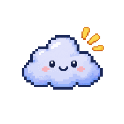
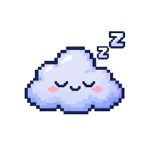
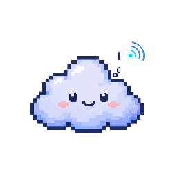
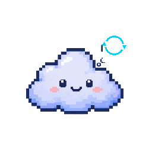
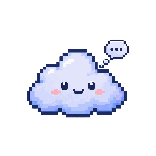
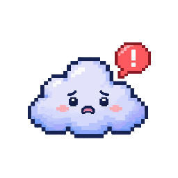

<p align="center">
  
</p>

<h1 align="center">Remote AI</h1>

<p align="center"><strong>Нативный macOS-компаньон для постоянной удалённой сессии Claude Code.</strong></p>

<p align="center">
  <a href="https://github.com/f2re/remote_ai/actions/workflows/macos-ci.yml"></a>
  
  
  
  
</p>

Remote AI держит Claude Code запущенным на удалённом Linux/macOS-сервере, синхронизирует обычную локальную папку проекта через Mutagen и показывает состояние сессии маленьким плавающим пиксельным облаком. Приложение не проксирует Claude Code и не хранит его OAuth/session credentials: используются OpenSSH, tmux и штатная авторизация Claude на сервере.

## Канонический маскот

Шесть изображений ниже — не mockup и не отдельная иллюстрация README. Это те же PNG, которые входят в resource bundle приложения и отображаются в runtime.

<table>
<tr>
<td align="center"><br><b>Не в сети</b></td>
<td align="center"><br><b>Подключение</b></td>
<td align="center"><br><b>Синхронизация</b></td>
</tr>
<tr>
<td align="center"><br><b>Claude работает</b></td>
<td align="center"><br><b>Ожидание ввода</b></td>
<td align="center"><br><b>Ошибка</b></td>
</tr>
</table>

Подробная спецификация: [`docs/MASCOT.md`](docs/MASCOT.md) и [`design/KIT.md`](design/KIT.md).

## Как это работает

```text
локальная папка проекта на Mac
          │
          ├──── Mutagen two-way-safe ────► удалённая рабочая папка
          │                                      │
Remote AI│                                      └── tmux ── Claude Code
  маскот  ├──── OpenSSH ─────────────────────────▲
          │
          └──── Warp / Terminal attach к уже существующей tmux-сессии
```

- проект остаётся в привычной локальной папке;
- Mutagen зеркалирует рабочее дерево, но не `.git`;
- Claude Code работает внутри именованной tmux-сессии и не останавливается при закрытии Terminal/Warp;
- маскот показывает подключение, синхронизацию, работу, ожидание и ошибку;
- клик по активному маскоту открывает Warp: локальный Git-обзор слева, текущая Claude-сессия справа;
- при ожидании пользователя приходит нативное уведомление macOS.

Подробнее: [`docs/ARCHITECTURE.md`](docs/ARCHITECTURE.md) и [`docs/WARP.md`](docs/WARP.md).

## Быстрый старт

### Mac

Требуется macOS 14+. Установите Mutagen:

```bash
brew install mutagen-io/mutagen/mutagen
```

OpenSSH уже входит в macOS. Warp опционален: при его отсутствии доступен Terminal.

### Удалённый сервер

```bash
tmux -V
claude --version
```

Claude Code должен быть заранее авторизован на самом сервере обычным способом.

### SSH

Рекомендуется `~/.ssh/config`:

```sshconfig
Host my-claude-server
    HostName 203.0.113.10
    User developer
    Port 22
    IdentityFile ~/.ssh/id_ed25519
```

В Settings Remote AI укажите SSH host/alias, пользователя, порт, удалённую корневую папку и локальный проект. Затем выполните **«Проверить настройку»** и **«Запустить / переподключить»**.

## Управление

Основной клик по маскоту контекстный:

- первый запуск → Settings;
- настроен сервер, но нет проекта → выбор проекта;
- offline/error → запуск или переподключение;
- активная сессия → Warp.

Контекстное меню содержит выбор проекта, запуск/переподключение, Warp, Terminal, остановку, Settings и завершение приложения.

## Безопасность данных

- Mutagen по умолчанию работает в `two-way-safe`;
- конфликты синхронизации блокируют продолжение и не разрешаются молча;
- `.git` не синхронизируется на сервер;
- перед остановкой runtime выполняется успешный `mutagen sync flush`;
- SSH host key проверяется OpenSSH; `StrictHostKeyChecking=no` не используется;
- Remote AI не читает, не копирует и не проксирует OAuth/session credentials Claude Code.

См. [`SECURITY.md`](SECURITY.md).

## Сборка

```bash
git clone --recurse-submodules https://github.com/f2re/remote_ai.git
cd remote_ai
swift test
./build.sh --install
open ~/Applications/RemoteAI.app
```

Релизная сборка — Universal 2 (`arm64 + x86_64`). `build.sh` также копирует канонический mascot resource bundle в `.app` и генерирует `AppIcon.icns` из `mascot-thinking.png`.

## Snapshot и release gate

```bash
./tools/snap.sh /tmp/RemoteAI-shots
./tools/verify-release.sh .build/app/RemoteAI.app /tmp/RemoteAI-shots 0.2.2
```

Gate проверяет unit tests, Universal 2, codesign, bundle metadata, `AppIcon.icns`, все 6 PNG внутри готового `.app`, 16 release screenshots, ZIP integrity и SHA-256.

## CI/CD и релизы

PR и `main` проходят macOS CI. Публикация выполняется веткой точного формата:

```text
release/publish-v0.2.2
```

Release workflow повторно проверяет текущий `main`, ставит тег только на проверенный SHA и публикует app ZIP, screenshots ZIP, SHA-256 и отдельные PNG. Без Developer ID/notarization secrets выпуск автоматически помечается prerelease.

Текущая процедура: [`docs/RELEASE.md`](docs/RELEASE.md).

## Разработка с BAMA

BAMA закреплён как submodule `vendor/bama`:

```bash
./scripts/claude-bama.sh
```

Основные документы:

| Документ | Назначение |
| --- | --- |
| [`docs/BRIEF.md`](docs/BRIEF.md) | продуктовый и UX-контракт |
| [`docs/ARCHITECTURE.md`](docs/ARCHITECTURE.md) | архитектура и границы безопасности |
| [`docs/MASCOT.md`](docs/MASCOT.md) | канонический маскот и asset pipeline |
| [`design/DESIGN-SYSTEM.md`](design/DESIGN-SYSTEM.md) | дизайн-система |
| [`design/KIT.md`](design/KIT.md) | визуальная спецификация облака |
| [`docs/RELEASE.md`](docs/RELEASE.md) | CI/CD и публикация |
| [`docs/LOCALIZATION.md`](docs/LOCALIZATION.md) | русскоязычный продуктовый контракт |
| [`CONTRIBUTING.md`](CONTRIBUTING.md) | порядок внесения изменений |

## Статус

Автоматические проверки покрывают сборку, ресурсы, snapshots и release packaging. Полный внешний E2E требует реального SSH-хоста, Mutagen и авторизованного Claude Code на сервере.
