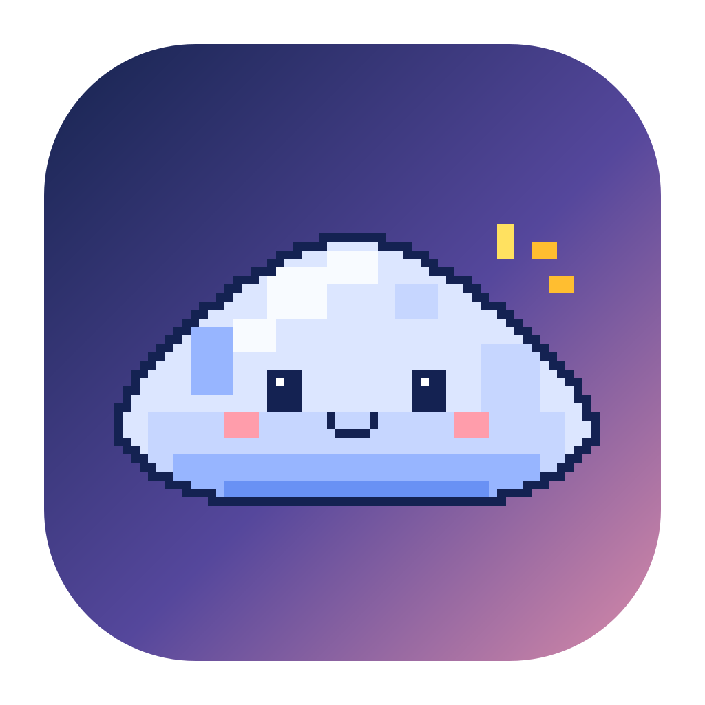

<p align="center">
  
</p>

<h1 align="center">Remote AI</h1>

<p align="center"><strong>Нативный macOS-компаньон для постоянной удалённой сессии Claude Code.</strong></p>

<p align="center">
  <a href="https://github.com/f2re/remote_ai/actions/workflows/macos-ci.yml"></a>
  
  
  
  
</p>

Remote AI позволяет держать Claude Code запущенным на удалённом Linux/macOS-сервере, работать с обычной локальной папкой проекта на Mac и видеть состояние сессии через маленького плавающего маскота. Приложение не заменяет Claude Code и не перехватывает его авторизацию: инфраструктуру обеспечивают OpenSSH, Mutagen и tmux.

## Зачем это нужно

Обычная удалённая работа с Claude Code требует вручную следить за SSH, tmux, синхронизацией файлов и возвратом к нужной сессии. Remote AI сводит этот цикл к одному состоянию маскота и нескольким действиям:

- локальный проект остаётся в привычной папке на Mac;
- Mutagen зеркалирует рабочее дерево на сервер в режиме `two-way-safe`;
- Claude Code запускается или повторно используется внутри именованной tmux-сессии;
- закрытие Terminal/Warp или временный разрыв сети не останавливают Claude;
- после восстановления связи изменения возвращаются на Mac;
- маскот показывает подключение, синхронизацию, работу Claude, ожидание ввода и ошибки;
- по клику открывается Warp с локальным Git-обзором и текущей удалённой Claude-сессией;
- когда Claude ждёт пользователя, приходит нативное уведомление macOS.

## Как это устроено

```text
macOS
┌──────────────────────────────────────────────────────────────┐
│ Remote AI                                                   │
│  маскот + Настройки + диагностика                           │
│      │                                                       │
│      ├── OpenSSH ───────────────► удалённый сервер           │
│      │                              └─ tmux ── Claude Code   │
│      │                                                       │
│      └── Mutagen two-way-safe ◄──► рабочая папка на сервер   │
│                                                              │
│ локальная папка проекта ◄──────────────────────────────────► │
└──────────────────────────────────────────────────────────────┘
```

Подробности: [`docs/ARCHITECTURE.md`](docs/ARCHITECTURE.md).

## Состояния маскота

| Состояние | Что означает |
| --- | --- |
| **Не в сети** | удалённая сессия или зеркало сейчас неактивны |
| **Подключение** | выполняются SSH-проверки и восстановление сессии |
| **Синхронизация** | Mutagen сканирует или переносит изменения |
| **Claude Code работает** | Claude выполняет задачу или использует инструменты |
| **Ожидание ввода** | Claude закончил ход или ждёт подтверждения пользователя |
| **Ошибка** | требуется внимание: конфликт синхронизации, SSH/runtime-сбой и т. п. |

<p align="center">
  
</p>

## Быстрый старт

### 1. Подготовьте Mac

Требуется macOS 14 или новее. Установите Mutagen:

```bash
brew install mutagen-io/mutagen/mutagen
```

OpenSSH уже входит в macOS. Warp необязателен: при его отсутствии Remote AI использует Terminal.

### 2. Подготовьте удалённый сервер

На сервере должны быть доступны:

```bash
tmux -V
claude --version
```

Claude Code должен быть уже авторизован обычным способом на самом сервере. Remote AI не читает и не передаёт OAuth/session credentials.

### 3. Настройте SSH

Рекомендуемый вариант — обычный `~/.ssh/config`:

```sshconfig
Host my-claude-server
    HostName 203.0.113.10
    User developer
    Port 22
    IdentityFile ~/.ssh/id_ed25519
```

В Remote AI достаточно указать `my-claude-server` как хост. Если поле «Путь к SSH-ключу» оставить пустым, используются `~/.ssh/config`, `ssh-agent` и стандартные ключи OpenSSH.

### 4. Запустите Remote AI

Скачайте текущий пакет на странице [Releases](https://github.com/f2re/remote_ai/releases), распакуйте `RemoteAI-<version>-macOS.zip` и откройте `RemoteAI.app`.

В **Настройках**:

1. укажите хост, пользователя, порт и удалённую корневую папку;
2. нажмите **«Выбрать проект…»**;
3. нажмите **«Проверить настройку»**;
4. убедитесь, что конфигурация, проект, SSH, Mutagen, tmux и Claude Code отмечены как готовые;
5. нажмите **«Запустить / переподключить»**.

<p align="center">
  
</p>

## Управление

Основной клик по маскоту контекстный:

- при первом запуске открывает недостающий шаг настройки;
- в состояниях «Не в сети» и «Ошибка» запускает/восстанавливает сессию;
- при активной сессии открывает обзор в Warp.

Контекстное меню содержит: **Выбрать проект…**, **Запустить / переподключить**, **Открыть обзор в Warp**, **Подключиться в Terminal**, **Остановить**, **Настройки…**, **Завершить Remote AI**.

## Безопасность данных

Remote AI придерживается консервативных правил:

- режим Mutagen по умолчанию — только `two-way-safe`;
- конфликт синхронизации отображается как блокирующая ошибка и не разрешается молча;
- устаревшие сессии Mutagen при смене маршрута приостанавливаются, а не удаляются;
- перед остановкой Claude выполняется успешный `mutagen sync flush`;
- `.git` не синхронизируется на сервер, чтобы не допустить параллельной порчи Git-метаданных;
- SSH host key проверяется стандартными средствами OpenSSH;
- `StrictHostKeyChecking=no` не используется;
- токены и данные авторизации Claude Code не копируются, не проксируются и не сохраняются приложением.

См. [`SECURITY.md`](SECURITY.md).

## Сборка из исходников

```bash
git clone --recurse-submodules https://github.com/f2re/remote_ai.git
cd remote_ai
swift test
./build.sh --install
open ~/Applications/RemoteAI.app
```

Релизная сборка — Universal 2 (`arm64 + x86_64`). Для отладочной сборки текущей архитектуры:

```bash
./build.sh --debug
```

Для сборки, установки и запуска:

```bash
./build.sh --open
```

## Проверка интерфейса

Детерминированные светлые и тёмные снимки реальных SwiftUI-представлений создаются командой:

```bash
./tools/snap.sh
```

Полный релизный пакет проверяется так:

```bash
./tools/verify-release.sh .build/app/RemoteAI.app /tmp/RemoteAI-shots 0.2.1
```

Проверяются архитектуры Universal 2, codesign, metadata bundle, версия, значок, 16 PNG и целостность релизных архивов.

## CI/CD и релизы

PR и `main` проходят macOS CI: тесты → release compile → Universal 2 → snapshots → проверка bundle/codesign → ZIP/SHA-256.

Публикация выполняется через ветку вида:

```text
release/publish-v0.2.1
```

Release workflow повторно проверяет текущий `main`, ставит неизменяемый тег на проверенный SHA и публикует приложение, screenshots ZIP, `SHA256SUMS.txt` и отдельные PNG. Если Developer ID/notarization secrets отсутствуют, выпуск помечается как prerelease. Подробности: [`docs/RELEASE.md`](docs/RELEASE.md).

## Разработка с BAMA

BAMA закреплён как submodule `vendor/bama` и остаётся источником правил разработки macOS. Локальные агенты Remote AI маршрутизируют задачи к BAMA, а не дублируют его.

```bash
./scripts/claude-bama.sh
```

Основные документы:

| Документ | Назначение |
| --- | --- |
| [`docs/BRIEF.md`](docs/BRIEF.md) | продуктовый и UX-контракт |
| [`docs/ARCHITECTURE.md`](docs/ARCHITECTURE.md) | архитектура и границы безопасности |
| [`docs/GLOSSARY.md`](docs/GLOSSARY.md) | единый русский словарь интерфейса |
| [`design/DESIGN-SYSTEM.md`](design/DESIGN-SYSTEM.md) | дизайн-система |
| [`design/KIT.md`](design/KIT.md) | спецификация пиксельного облака |
| [`docs/RELEASE.md`](docs/RELEASE.md) | CI/CD и публикация |
| [`docs/LOCALIZATION.md`](docs/LOCALIZATION.md) | правила русскоязычного продукта |
| [`CONTRIBUTING.md`](CONTRIBUTING.md) | порядок внесения изменений |

## Язык проекта

Пользовательский интерфейс, диагностика, уведомления, release notes, README и проектная документация Remote AI ведутся **на русском языке**. Английскими остаются только технические идентификаторы, команды, имена API/библиотек и необработанный вывод внешних инструментов, если он формируется не Remote AI.

## Статус

Remote AI остаётся ранним продуктом. Автоматические проверки покрывают сборку и детерминированные состояния, но окончательный E2E на реальном пользовательском сервере требует настоящего SSH-хоста, Mutagen и авторизованного Claude Code. Актуальный чек-лист ведётся в issue #21.
